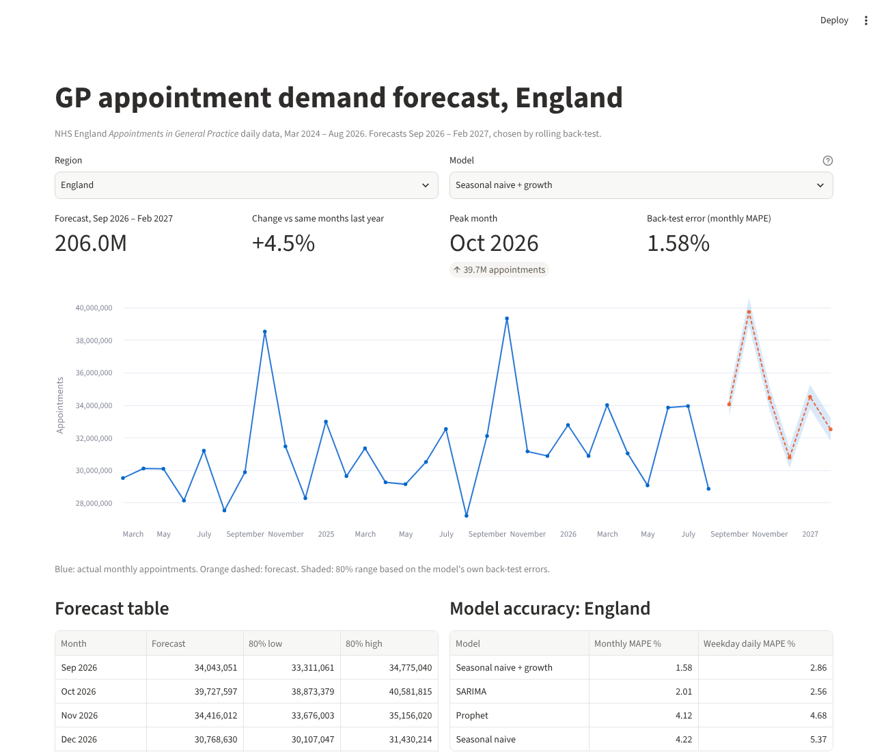
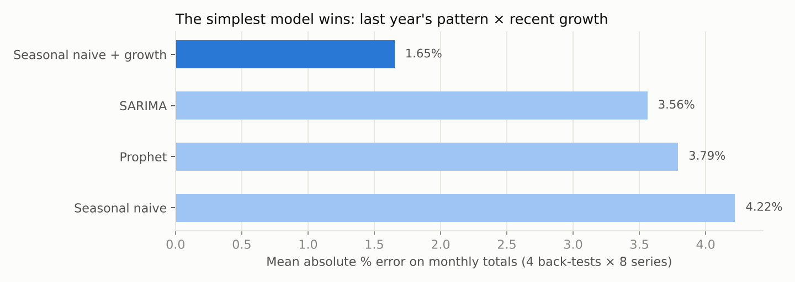
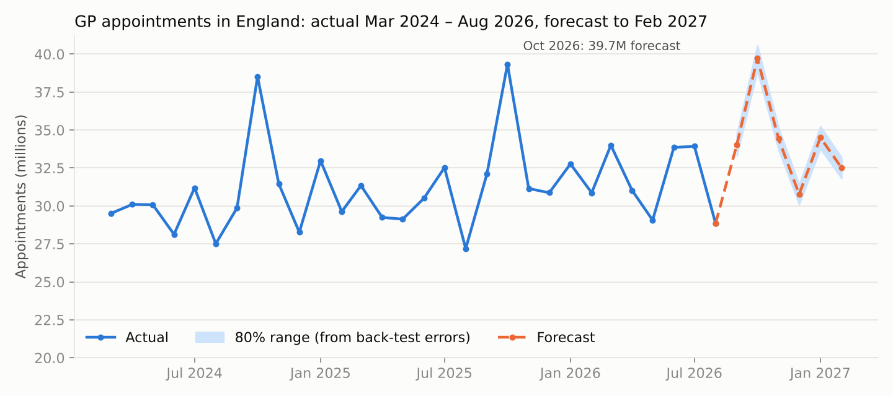

# NHS GP Appointment Demand Forecasting

**Forecasts monthly GP appointments for England and its 7 NHS regions six months ahead, with 1.6% average error in back-testing. A simple "last year × recent growth" model beat SARIMA and Prophet. England is forecast to need 206 million appointments from Sep 2026 to Feb 2027, 4.5% more than a year earlier, with a peak of 39.7 million in October.**

`Python` · `pandas` · `statsmodels (SARIMA)` · `Prophet` · `Streamlit` · `Altair` · `Time-series back-testing`



---

## The problem

GP practices and Integrated Care Boards set staff rotas and book locum cover weeks ahead. Demand swings by more than 30% across the year: every October, flu and COVID vaccination appointments push the total near 39 million, and August drops to about 27 million. Planners need a forecast they can trust, plus a clear sense of how wrong it might be.

## Data

NHS England's [Appointments in General Practice](https://digital.nhs.uk/data-and-information/publications/statistical/appointments-in-general-practice) (August 2026 release):

- **Daily counts** by sub-ICB area, appointment status, staff type and mode, from 1 Mar 2024 to 31 Aug 2026. That's 30 monthly files and about 10 million rows.
- **Coverage**: practices and registered patients included each month.

`src/prepare.py` aggregates this to **835 million appointments** as daily series for England and each of the 7 NHS regions.

## Method

Four models, scored with a **rolling-origin back-test**. Each model forecasts 3 complete months ahead from 4 different starting points (Aug 2025, Nov 2025, Feb 2026, May 2026), for all 8 series: 128 forecasts in total, every one scored on data the model hadn't seen.

| Model | How it works |
| --- | --- |
| Seasonal naive | Same weekday 52 weeks earlier, the baseline to beat |
| **Seasonal naive + growth** | Last year's daily pattern × year-on-year growth over the last 13 weeks |
| SARIMA | SARIMAX on the log ratio to last year, with bank-holiday and Christmas flags |
| Prophet | Weekly + yearly seasonality, multiplicative, England bank holidays and Christmas |



**The simplest model wins in all 8 series.** With only 2.5 years of history there are just two Octobers to learn from. SARIMA and Prophet spend that data estimating seasonal shapes, while "last year × growth" copies the real shape directly. Its error is **61% lower than the plain baseline** and **56% lower than Prophet**.

An early SARIMA modelled raw log appointments and drifted badly, with 15% error. Re-framing it to model the ratio to last year cut that to 3.6%.

## Forecast: Sep 2026 – Feb 2027



| Region | Forecast (millions) | vs same months last year | Back-test error |
| --- | ---: | ---: | ---: |
| **England** | **206.0** | **+4.5%** | 1.58% |
| Midlands | 41.1 | +5.7% | 1.63% |
| North East and Yorkshire | 32.8 | +4.6% | 1.60% |
| South East | 30.7 | +3.1% | 1.77% |
| London | 30.4 | +4.4% | 1.83% |
| East of England | 24.9 | +6.0% | 1.39% |
| North West | 23.8 | +4.0% | 1.71% |
| South West | 22.2 | +3.2% | 1.71% |

The 80% range on each forecast comes from that model's own back-test errors, so it shows how far off the model has actually been rather than a theoretical interval.

**Demand per patient is rising.** Registered patients at included practices fell 0.9% between Aug 2025 and Aug 2026, while appointments grew. The extra demand comes from more appointments per person, not from more people.

## The app

`app.py` is a Streamlit app. Choose a region and a model to see the history, the forecast with its 80% range, the monthly table and each model's back-test accuracy.

```bash
streamlit run app.py
```

Deploy it free on [Streamlit Community Cloud](https://share.streamlit.io): New app → this repository → `app.py`. The app reads only the small files in `outputs/`.

## Run the pipeline

```bash
pip install -r requirements.txt
# 1. Download "Daily counts" (zip) from the latest Appointments in General Practice release
#    and unzip it into data/raw/daily/
python src/prepare.py    # ~15 s: 10M rows -> daily regional series
python src/forecast.py   # ~1 min: back-test 4 models x 8 series x 4 origins, then forecast
python src/charts.py     # README charts
```

The raw files (1.4 GB) aren't in the repo; `data/processed/` and `outputs/` are.

## Limitations

- Two and a half years of history means only two Octobers. If the vaccination programme's timing changes, the October forecast is the most at risk.
- Several ICBs merged in 2026. Regional series follow the region codes as published each month; England totals are unaffected.
- Coverage varies slightly month to month as practices join or leave the data. Appointments aren't adjusted per registered patient.

*Data: NHS England, Appointments in General Practice, Open Government Licence v3.0.*
